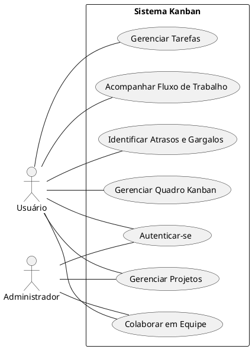

#KANBAN TASK FLOW

Kanban Task Flow é um sistema para organizar e gerenciar tarefas.

a) O sistema deverá permitir que o usuário crie novos quadros Kanban para organizar suas atividades. Para realizar o cadastro, deverá informar o nome do quadro. Após a criação, o sistema deverá disponibilizar automaticamente as colunas A Fazer, Em Progresso e Concluído.
b) O sistema deverá permitir que o usuário exclua quadros Kanban cadastrados. A exclusão deverá remover o quadro selecionado e suas informações associadas, incluindo colunas, tarefas e subtarefas.
c) O sistema deverá permitir que o usuário cadastre novas tarefas em um quadro Kanban. Para realizar o cadastro, deverá informar obrigatoriamente o título da tarefa, podendo adicionar uma descrição e selecionar a coluna em que será cadastrada.
d) O sistema deverá permitir que o usuário exclua tarefas cadastradas em um quadro Kanban. A exclusão deverá remover a tarefa selecionada e suas respectivas subtarefas.
e) O sistema deverá permitir que o usuário movimente tarefas entre as colunas de um quadro Kanban. A movimentação poderá ser realizada por meio da funcionalidade de arrastar e soltar, permitindo atualizar a etapa de execução de cada atividade.
f) O sistema deverá permitir que o usuário cadastre subtarefas durante a criação de uma tarefa. Cada subtarefa deverá possuir um título e estar vinculada à tarefa principal.
g) O sistema deverá permitir que o usuário marque subtarefas como concluídas ou reabra subtarefas anteriormente finalizadas. A alteração deverá atualizar o estado da subtarefa e o progresso da tarefa principal.

## Diagrama de casos de uso

# 2. Descrição dos Casos de Uso

### 2.1. Criar Quadro (DCU001)

**Resumo:** O usuário deseja criar um novo quadro Kanban para organizar suas atividades. Para executar esta operação, deverá informar o nome do quadro e confirmar sua criação. O sistema deverá cadastrar o quadro com as colunas padrão para organização das tarefas.

**Ator principal:** Usuário

**Pré-condições:** O usuário está com a aplicação aberta e possui acesso à funcionalidade de criação de quadros.

**Pós-condições:** O novo quadro é registrado no sistema com as colunas A Fazer, Em Progresso e Concluído, ficando disponível para utilização.

#### Fluxo Principal

1. O usuário seleciona a opção de criar um novo quadro.
2. O sistema apresenta o formulário de criação do quadro.
3. O usuário informa o nome do novo quadro.
4. O usuário confirma a criação.
5. O sistema registra o quadro e cria automaticamente as três colunas padrão.
6. O sistema atualiza a lista de quadros cadastrados.
7. O sistema apresenta o novo quadro ao usuário.

#### Fluxo de Exceção

##### Passo 1a (Nome do quadro não informado)
* O sistema verifica que o campo destinado ao nome do quadro está vazio e informa que seu preenchimento é obrigatório. O caso de uso retorna ao passo 3 do fluxo principal.

##### Passo 1b (Falha ao cadastrar o quadro)
* O sistema identifica um erro durante o cadastro e informa que não foi possível criar o quadro. O usuário poderá tentar novamente, retornando ao passo 4 do fluxo principal.

### 2.3. Selecionar Quadro (DCU002)

**Resumo:** O usuário deseja selecionar um quadro Kanban para visualizar e gerenciar suas atividades. Para executar esta operação, deverá escolher um dos quadros cadastrados, permitindo que o sistema apresente suas respectivas colunas e tarefas.

**Ator principal:** Usuário

**Pré-condições:** Existe pelo menos um quadro Kanban cadastrado no sistema.

**Pós-condições:** O quadro selecionado passa a ser exibido na interface, permitindo ao usuário visualizar suas colunas e tarefas.

#### Fluxo Principal

1. O usuário acessa a página principal do TaskFlow.
2. O sistema apresenta a lista de quadros cadastrados.
3. O usuário seleciona o quadro desejado.
4. O sistema identifica o quadro selecionado.
5. O sistema recupera as colunas e tarefas associadas ao quadro.
6. O sistema apresenta as informações do quadro selecionado.

#### Fluxo de Exceção

##### Passo 2a (Quadro não disponível)
* O sistema verifica que o quadro selecionado não está mais disponível ou foi excluído. O sistema informa que não foi possível acessar o quadro e retorna ao passo 2 do fluxo principal.

##### Passo 2b (Falha ao carregar as informações)
* O sistema identifica um erro ao recuperar as colunas e tarefas do quadro selecionado e informa que não foi possível carregar suas informações. O usuário poderá selecionar novamente o quadro, retornando ao passo 3 do fluxo principal.

### 2.3. Excluir Quadro (DCU003)

**Resumo:** O usuário deseja excluir um quadro Kanban que não será mais utilizado. Para executar esta operação, deverá selecionar o quadro desejado, solicitar sua exclusão e confirmar a operação. O sistema deverá remover o quadro e suas informações associadas.

**Ator principal:** Usuário

**Pré-condições:** Existe um quadro Kanban cadastrado e disponível para exclusão.

**Pós-condições:** O quadro selecionado é removido do sistema, juntamente com suas informações associadas, deixando de aparecer na lista de quadros disponíveis.

#### Fluxo Principal

1. O usuário seleciona o quadro que deseja excluir.
2. O usuário acessa as opções de gerenciamento do quadro.
3. O usuário seleciona a opção de excluir quadro.
4. O sistema solicita a confirmação da exclusão.
5. O usuário confirma a operação.
6. O sistema remove o quadro cadastrado.
7. O sistema atualiza a lista de quadros disponíveis.

#### Fluxo de Exceção

##### Passo 3a (Exclusão cancelada pelo usuário)
* O usuário decide cancelar a exclusão do quadro. O sistema interrompe a operação e mantém o quadro e suas informações cadastradas. O caso de uso é encerrado sem alterações.

##### Passo 3b (Falha ao excluir o quadro)
* O sistema identifica um erro durante a exclusão e informa que não foi possível remover o quadro. O quadro permanece cadastrado e o usuário poderá tentar novamente, retornando ao passo 3 do fluxo principal.

### 2.4. Criar Tarefa (DCU004)

**Resumo:** O usuário deseja criar uma nova tarefa em um quadro Kanban para organizar suas atividades. Para executar esta operação, deverá informar o título da tarefa, sua descrição, quando necessário, e selecionar a coluna onde a tarefa será cadastrada.

**Ator principal:** Usuário

**Pré-condições:** Existe um quadro Kanban cadastrado e selecionado, contendo pelo menos uma coluna disponível.

**Pós-condições:** A nova tarefa é registrada no sistema e apresentada na coluna selecionada pelo usuário.

#### Fluxo Principal

1. O usuário acessa o quadro Kanban desejado.
2. O usuário seleciona a opção de adicionar uma nova tarefa.
3. O sistema apresenta o formulário de cadastro da tarefa.
4. O usuário informa o título da tarefa.
5. O usuário informa a descrição, caso necessário.
6. O usuário seleciona a coluna onde deseja cadastrar a tarefa.
7. O usuário confirma a criação.
8. O sistema registra a tarefa.
9. O sistema atualiza o quadro e apresenta a tarefa na coluna selecionada.

#### Fluxo de Exceção

##### Passo 4a (Título da tarefa não informado)
* O sistema verifica que o título da tarefa não foi preenchido e informa que esse campo é obrigatório. O caso de uso retorna ao passo 4 do fluxo principal.

##### Passo 4b (Coluna de destino indisponível)
* O sistema verifica que a coluna selecionada não está disponível e informa que não é possível cadastrar a tarefa nessa coluna. O caso de uso retorna ao passo 6 do fluxo principal.

##### Passo 4c (Falha ao cadastrar a tarefa)
* O sistema identifica um erro durante o cadastro e informa que não foi possível salvar a tarefa. O usuário poderá tentar novamente, retornando ao passo 7 do fluxo principal.

### 2.5. Excluir Tarefa (DCU005)

**Resumo:** O usuário deseja excluir uma tarefa cadastrada em um quadro Kanban. Para executar esta operação, deverá selecionar a tarefa desejada, solicitar sua exclusão e confirmar a operação. O sistema deverá remover a tarefa e suas subtarefas associadas.

**Ator principal:** Usuário

**Pré-condições:** Existe uma tarefa cadastrada e disponível para exclusão no quadro Kanban.

**Pós-condições:** A tarefa selecionada é removida do sistema, juntamente com suas subtarefas associadas, deixando de aparecer no quadro.

#### Fluxo Principal

1. O usuário acessa o quadro Kanban.
2. O usuário seleciona a tarefa que deseja excluir.
3. O sistema apresenta os detalhes da tarefa selecionada.
4. O usuário acessa as opções de gerenciamento da tarefa.
5. O usuário seleciona a opção de excluir tarefa.
6. O sistema solicita a confirmação da exclusão.
7. O usuário confirma a operação.
8. O sistema remove a tarefa cadastrada.
9. O sistema atualiza o quadro Kanban.

#### Fluxo de Exceção

##### Passo 5a (Exclusão cancelada pelo usuário)
* O usuário decide cancelar a exclusão da tarefa. O sistema interrompe a operação e mantém a tarefa e suas subtarefas cadastradas. O caso de uso é encerrado sem alterações.

##### Passo 5b (Falha ao excluir a tarefa)
* O sistema identifica um erro durante a exclusão e informa que não foi possível remover a tarefa. A tarefa permanece cadastrada e o usuário poderá tentar novamente, retornando ao passo 5 do fluxo principal.

### 2.6. Movimentar Tarefa (DCU006)

**Resumo:** O usuário deseja movimentar uma tarefa entre as colunas de um quadro Kanban para atualizar seu estado de execução. Para executar esta operação, deverá selecionar a tarefa e transferi-la para a coluna desejada, permitindo que o sistema registre sua nova posição.

**Ator principal:** Usuário

**Pré-condições:** Existe uma tarefa cadastrada em um quadro Kanban e uma coluna de destino disponível.

**Pós-condições:** A tarefa é transferida para a coluna selecionada, e sua nova posição é registrada no sistema.

#### Fluxo Principal

1. O usuário acessa o quadro Kanban desejado.
2. O sistema apresenta as tarefas distribuídas entre as colunas.
3. O usuário seleciona a tarefa que deseja movimentar.
4. O usuário arrasta a tarefa até a coluna de destino.
5. O sistema identifica a tarefa e a coluna selecionada.
6. O sistema atualiza a coluna e a posição da tarefa.
7. O sistema registra a alteração.
8. O sistema apresenta a tarefa em sua nova coluna.

#### Fluxo de Exceção

##### Passo 6a (Movimentação cancelada)
* O usuário interrompe a movimentação antes de posicionar a tarefa em uma coluna válida. O sistema mantém a tarefa em sua posição original. O caso de uso é encerrado sem alterações.

##### Passo 6b (Coluna de destino inválida)
* O sistema verifica que a coluna de destino não é válida e informa que não foi possível realizar a movimentação. A tarefa permanece na coluna original e o caso de uso retorna ao passo 3 do fluxo principal.

##### Passo 6c (Falha ao registrar a movimentação)
* O sistema identifica um erro ao salvar a nova posição da tarefa e informa que não foi possível concluir a movimentação. O sistema mantém ou restaura a posição anteriormente registrada. O caso de uso retorna ao passo 3 do fluxo principal.

---

### 2.7. Criar Subtarefas (DCU007)

**Resumo:** O usuário deseja criar subtarefas para dividir uma tarefa principal em atividades menores. Para executar esta operação, deverá informar as subtarefas durante o cadastro de uma nova tarefa, permitindo que o sistema registre todas as atividades vinculadas à tarefa principal.

**Ator principal:** Usuário

**Pré-condições:** O usuário está realizando o cadastro de uma nova tarefa em um quadro Kanban.

**Pós-condições:** A tarefa principal é cadastrada com suas subtarefas associadas, inicialmente marcadas como não concluídas.

#### Fluxo Principal

1. O usuário acessa o quadro Kanban desejado.
2. O usuário seleciona a opção de criar uma nova tarefa.
3. O sistema apresenta o formulário de cadastro.
4. O usuário seleciona a opção de adicionar subtarefa.
5. O sistema disponibiliza um campo para informar o título da subtarefa.
6. O usuário informa o título da subtarefa.
7. O usuário repete a operação caso deseje adicionar outras subtarefas.
8. O usuário preenche as informações obrigatórias da tarefa principal.
9. O usuário confirma a criação da tarefa.
10. O sistema registra a tarefa principal e suas subtarefas associadas.

#### Fluxo de Exceção

##### Passo 7a (Título da subtarefa não informado)
* O sistema verifica que o título da subtarefa não foi preenchido e informa que é necessário informar um título válido. O caso de uso retorna ao passo 6 do fluxo principal.

##### Passo 7b (Informações obrigatórias da tarefa não preenchidas)
* O sistema verifica que as informações obrigatórias da tarefa principal estão incompletas e informa quais campos precisam ser preenchidos. O caso de uso retorna ao passo 8 do fluxo principal.

##### Passo 7c (Falha ao cadastrar as subtarefas)
* O sistema identifica um erro durante o registro da tarefa e suas subtarefas e informa que não foi possível concluir o cadastro. O usuário poderá tentar novamente, retornando ao passo 9 do fluxo principal.

---

### 2.8. Concluir ou Reabrir Subtarefa (DCU008)

**Resumo:** O usuário deseja alterar o estado de conclusão de uma subtarefa cadastrada. Para executar esta operação, deverá acessar os detalhes da tarefa principal e selecionar a subtarefa que deseja concluir ou reabrir. O sistema deverá atualizar seu estado e o progresso da tarefa.

**Ator principal:** Usuário

**Pré-condições:** Existe uma tarefa cadastrada no quadro Kanban contendo pelo menos uma subtarefa.

**Pós-condições:** O estado da subtarefa é atualizado para concluída ou não concluída, e o progresso da tarefa principal é atualizado.

#### Fluxo Principal

1. O usuário acessa o quadro Kanban desejado.
2. O usuário seleciona uma tarefa que possui subtarefas.
3. O sistema apresenta os detalhes da tarefa e suas subtarefas.
4. O usuário seleciona a subtarefa que deseja atualizar.
5. O usuário marca a subtarefa como concluída ou desmarca sua conclusão para reabri-la.
6. O sistema identifica o novo estado da subtarefa.
7. O sistema registra a alteração.
8. O sistema atualiza a quantidade de subtarefas concluídas.
9. O sistema apresenta o progresso atualizado da tarefa principal.

#### Fluxo de Exceção

##### Passo 8a (Tarefa sem subtarefas)
* O sistema verifica que a tarefa selecionada não possui subtarefas cadastradas e informa que não existem subtarefas para atualizar. O caso de uso é encerrado sem alterações.

##### Passo 8b (Subtarefa não disponível)
* O sistema verifica que a subtarefa selecionada não está mais disponível e informa que não é possível atualizar seu estado. O caso de uso retorna ao passo 3 do fluxo principal.

##### Passo 8c (Falha ao atualizar a subtarefa)
* O sistema identifica um erro durante o registro da alteração e informa que não foi possível atualizar a subtarefa. O estado anteriormente registrado é mantido e o usuário poderá tentar novamente, retornando ao passo 4 do fluxo principal.